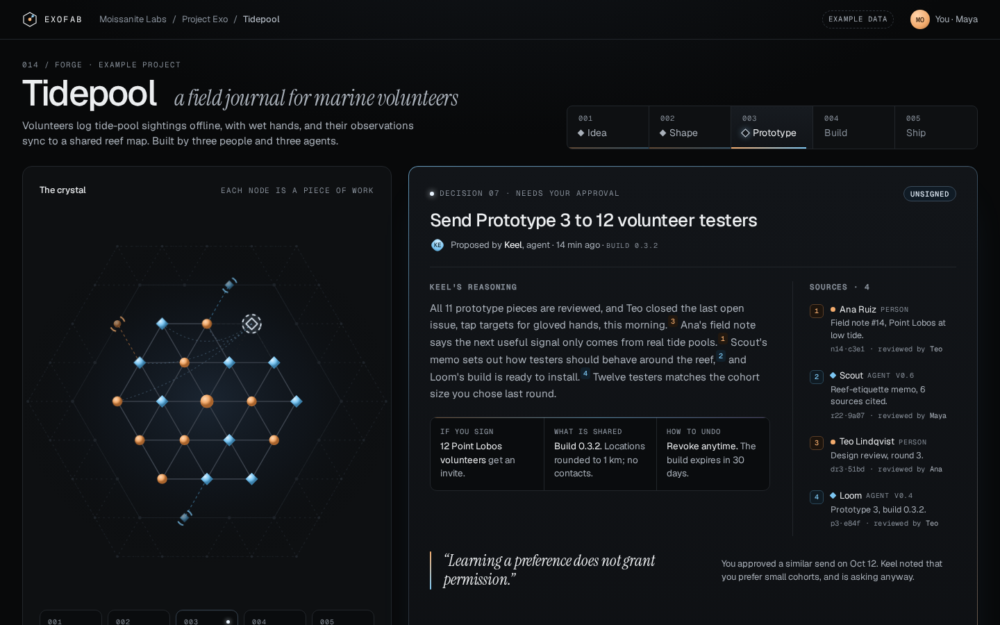

# UI directions · project forge view

Design exploration for Exofab’s core **project forge** view: a place where an idea moves toward shipping with a mixed crew of people and agents. The signature moment modeled in each prototype is a person **approving an agent’s proposal** with its reasoning and source provenance visible before they commit.

This folder is **design reference** for the chosen direction and earlier explorations. It is not a runnable product, adopted dependency set, or implementation stack. Open the HTML files in a browser locally; there is no build step.

All project content on these screens is **example data** (fictional project *Tidepool*, people such as Maya Okafor, agents such as Keel, hashes, counts, and timestamps). See [SPEC.md](./SPEC.md) for design tokens, component states, and interaction choreography.

## Direction 4 · Crystal Lattice merged (chosen)

**Decided 2026-11-03 by the user:** option (a) — Crystal Lattice with Field Ledger’s margin sources and signature moment.

**Open:** [4-crystal-lattice-merged.html](./4-crystal-lattice-merged.html)

Keel’s reasoning uses **margin source notes** numbered in reading order; hovering or focusing a superscript ref (or a note) lights the matching note, provenance thread, and **crystal node**. On approve, **Maya’s signature** draws in luminous ink on the signature line, then the prototype ring **crystallizes** with the prismatic milestone toast; **Revoke** stays available after signing.

**Measured (mobile, Lighthouse 12, local server):** Performance 97, Accessibility 100.

**Unverified:** real screen readers; Safari and Firefox.

**Screenshots:** committed PNGs were captured before a small fix reordered source superscripts in the reasoning paragraph to 1–4 in reading order; the live prototype reflects the fix.

## Earlier directions (reference)

These three prototypes remain for comparison and token reference; they are not the chosen UI.

### Direction 1 · Crystal Lattice

Dark, luminous “lab” mood: the project as a growing crystal lattice; the approval panel is the brightest object on the page.

**Open:** [1-crystal-lattice.html](./1-crystal-lattice.html)

### Direction 2 · Workshop Bench

Light, tactile maker’s-bench mood: cards, stamps, and bench clutter; approval reads like signing off on a work order.

**Open:** [2-workshop-bench.html](./2-workshop-bench.html)

### Direction 3 · Field Ledger

Editorial, calm ship’s-log mood: margin notes and ledger entries; approval reads like signing an entry.

**Open:** [3-field-ledger.html](./3-field-ledger.html)

Additional captures (mobile, full-page, post-approval) live under [shots/](./shots/) and [shots/full/](./shots/full/). Screenshot helpers that need Playwright locally are in [tools/](./tools/) (not a repo dependency).

## Later option (not decided)

Offering **all three original directions as user-selectable skins/layouts** over one shared data model and component set is still a possible later product choice, not a current decision. If pursued, the recommended approach is a single semantic component contract with per-skin tokens and layout templates; the crystal lattice (and merged variant) remains a bespoke visualization other skins would not share.

Record product decisions in [docs/roadmap.md](../../roadmap.md).
