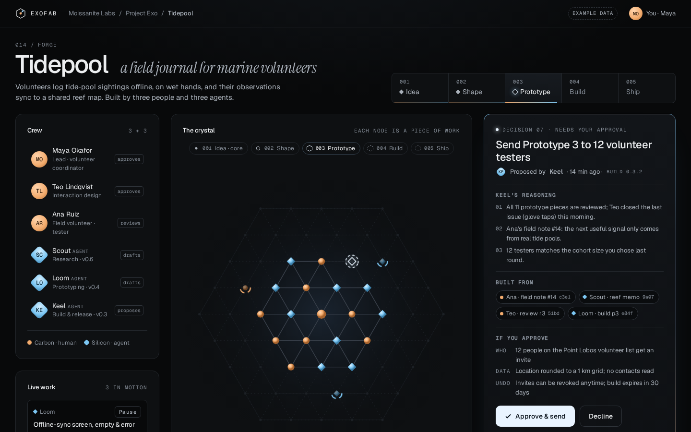
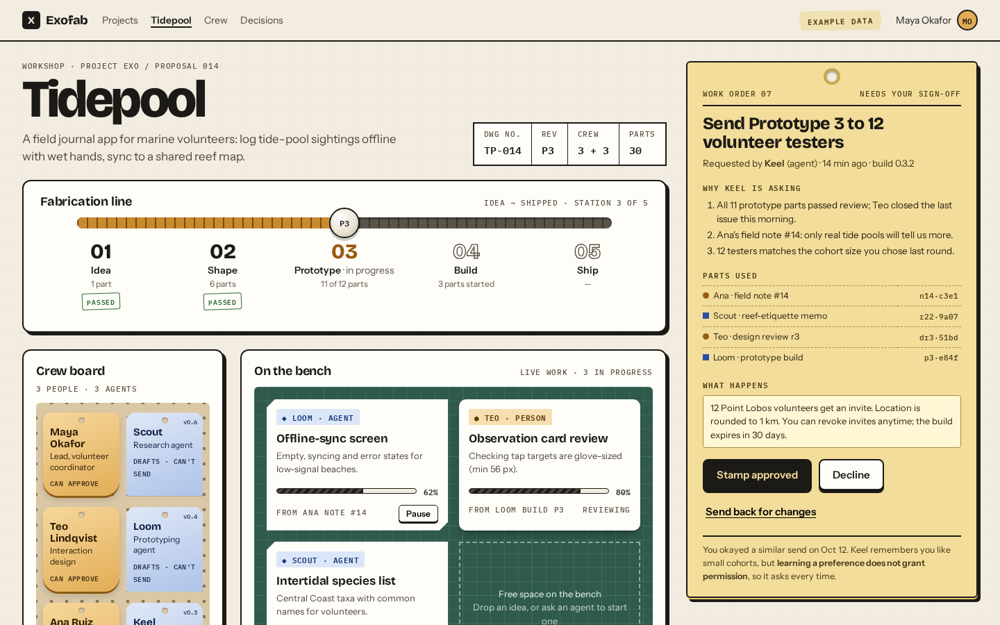
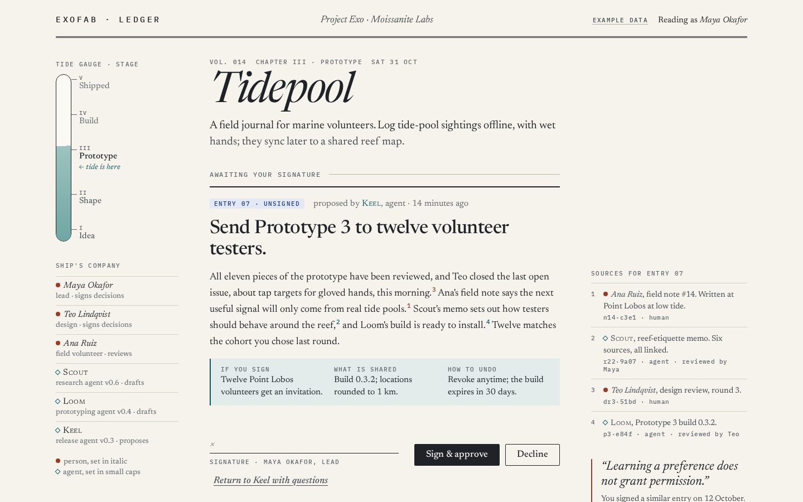

# UI directions · project forge view

Design exploration for Exofab’s core **project forge** view: a place where an idea moves toward shipping with a mixed crew of people and agents. The signature moment modeled in each prototype is a person **approving an agent’s proposal** with its reasoning and source provenance visible before they commit.

This folder is **reference material for team review**, not an adopted UI stack, dependency set, or product decision. Open the HTML files in a browser locally; there is no build step.

All project content on these screens is **example data** (fictional project *Tidepool*, people such as Maya Okafor, agents such as Keel, hashes, counts, and timestamps). See [SPEC.md](./SPEC.md) for design tokens, component states, and interaction choreography per direction.

## Direction 1 · Crystal Lattice

Dark, luminous “lab” mood: the project as a growing crystal lattice; the approval panel is the brightest object on the page.

**Open:** [1-crystal-lattice.html](./1-crystal-lattice.html) (file URL or “Open with Live Server” in an editor).

## Direction 2 · Workshop Bench

Light, tactile maker’s-bench mood: cards, stamps, and bench clutter; approval reads like signing off on a work order.

**Open:** [2-workshop-bench.html](./2-workshop-bench.html)

## Direction 3 · Field Ledger

Editorial, calm ship’s-log mood: margin notes and ledger entries; approval reads like signing an entry.

**Open:** [3-field-ledger.html](./3-field-ledger.html)

Additional captures (mobile, full-page, post-approval) live under [shots/](./shots/) and [shots/full/](./shots/full/). Screenshot helpers that need Playwright locally are in [tools/](./tools/) (not a repo dependency).

## Decision needed

The team should choose one of the following (or record a variant):

| Option | Description |
| --- | --- |
| **(a)** | **Crystal Lattice** with **Field Ledger’s signature moment** and **margin sources** (designer’s pick) |
| **(b)** | **Crystal Lattice** as in [1-crystal-lattice.html](./1-crystal-lattice.html) |
| **(c)** | **Workshop Bench** |
| **(d)** | **Field Ledger** |
| **(e)** | Offer **all three as user-selectable skins/layouts** over one shared data model and component set |

If **(e)** is chosen, the recommended approach is a **single semantic component contract** (crew, stages, pending decision, provenance, trace, approve/decline/revise) with **per-skin design tokens and layout templates**. The open cost is that the **crystal lattice visualization is a bespoke component** the other skins do not share; Workshop and Field Ledger can reuse more of the same structural components.

Record the outcome in [docs/roadmap.md](../../roadmap.md) when decided.

## Not verified

- Lighthouse not run on these static prototypes
- No screen-reader pass beyond what is noted in SPEC.md
- Google Fonts fallback behavior untested (prototypes load fonts from the network)
